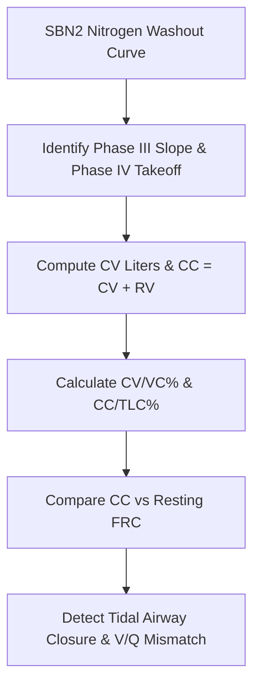

# Pulmonary SBN2 Closing Volume Personal Agent Skill

[](LICENSE)
[](https://www.python.org/)
[]()
[]()
[]()

Deterministic, zero-mock personal agent micro-skill for calculating Closing Volume (CV), Closing Capacity (CC), CV/VC%, CC/TLC%, and Phase III Slope ($\Delta N_2\%/\text{L}$) using Single-Breath Nitrogen Washout gas physics.

## Architecture



## Quickstart

```python
from client import NitrogenWashoutClosingVolumeClient

client = NitrogenWashoutClosingVolumeClient()
result = client.evaluate_sbn2(
    vital_capacity_vc_l=4.5,
    closing_volume_cv_l=0.55,
    residual_volume_rv_l=1.2,
    phase3_slope_n2_pct_per_l=1.1,
    functional_residual_capacity_frc_l=2.8
)
print(result)
```

## License

Apache-2.0
